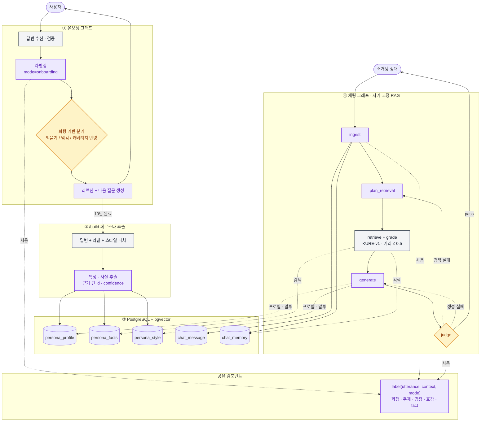

# AI 성능지표 체계

> 기준일 2026-10-21 · 코드 기준 `KTB4-17th-AI` dev `6feaa53` (PR #181)
>
> **측정 기준 모델**
> - L1~L12 · S1~S2 · C1~C6 "V1 현재값" = Langfuse 2,900건(평가 2,798건, 2026-09-29~10-07). **Gemini 3.1 Flash Lite 약 79% + Gemini 2.5 Flash Lite 약 21% 혼합** (OpenRouter). 모델별로 분리 집계되지 않음.
> - Q3 · Q4 = 09 기능별 성능평가 결과 보고서 값 (Gemini 계열, 버전은 보고서 확인 필요).
> - Q2 = 규칙 기반 가드레일(`app/core/guardrail`), 모델 없음.
> - R1~R4 = KURE-v1 ONNX int8 임베더.
> - **Kanana (`kakaocorp/kanana-2-3b-instruct`, RunPod vLLM) 측정값은 아직 없음.** F2·F3는 PR #149부터 Kanana로 가고 콜드 스타트 시 Gemini로 폴백하지만, 그 이후 Langfuse 데이터는 아직 집계하지 않았다.

#### 현재 AI 기능 및 스택

| 버전 | 서비스 | AI 기능 | 대표 스택 |
| --- | --- | --- | --- |
| V1 | 페르소나 온보딩 | 온보딩 문답 생성 (F1) | FastAPI, OpenAI 호환 클라이언트, Gemini 3.1 Flash Lite (OpenRouter), Pydantic |
| V1→V2 | 페르소나 온보딩 | 온보딩 태깅 (F2) | Kanana vLLM (RunPod) + 콜드 스타트 시 Gemini 3.1 Flash Lite 폴백 (PR #149), JSON 구조화 출력, 미근거 차원 null 처리 |
| V1→V2 | 페르소나 온보딩 | 페르소나 요약·생성 (F3) | Kanana vLLM + Gemini 폴백 (PR #149), 결정적 파싱·통계 모듈, 근거 인용 |
| V1→V2 | 페르소나 온보딩 | 문답·태깅·요약 자체 모델 전환 (1차) | Kanana, vLLM, teacher 증류 파이프라인(`label_with_teacher.py` · `score_teacher_gold.py`), LoRA/QLoRA SFT → DPO (`haru-dialogue`), SFT 증류 (`persona-extract`) |
| V1 | 페르소나 학습 | 말투·특성 추출 (카카오톡 업로드) | 비동기 Job (202 + 폴링), 결정적 파서, 최근 본인 발화 200건 샘플링, 업로드 5MB 상한 |
| V2 | 페르소나 학습 | 추출 자체 모델 전환 (2차) | Kanana + `persona-extract` 어댑터 공유 |
| V2 | 페르소나 메모리 | fact 추출·임베딩·검색 (RAG) | KURE-v1 ONNX int8 (CPU), pgvector, 코사인 거리 상한 0.5 (PR #179, 기존 0.65) |
| V1 | 연습 대화 | 연습 대화 1턴 (F4) | LLM Streaming, SSE, 정체 치환 가드레일, 프롬프트 템플릿 고정 |
| V2 | 연습 대화 | 메모리 RAG 연습대화 | v2 메모리 검색, 말 편하게 하기 제안 (PR #157) |
| V1 | 가상 소개팅 | 10라운드 시뮬레이션 (F5) | LangGraph, 라운드 단위 SSE, 1회 재시도, 동시 실행 20 제한 |
| V2 | 가상 소개팅 | 시뮬레이션 하네스 | 공통 소재 매칭 (τ 0.62) · 규칙 검사(rule_check) · LLM 심사 · 수정, **POST 동기 응답** (PR #178) |
| V1 | 리포트 | 시뮬 리포트 서술 (F6) | DB 정본 저장, GET/POST 분리, single-flight, `input_fingerprint` |
| V1 | 대화 정리 | 정리 초안 3개·발신 메시지 (F7) | LLM JSON 출력, 10초 타임아웃, `request_id` 멱등 키 (PR #166), 실패 시 200 + 실패 표시 응답, 입력 1000자 (PR #153) |
| V2 이후 | 페르소나 대화 | 연습·가상 소개팅 자체 모델 전환 | 온보딩 결과 확인 후 결정 (`haru-dialogue` 확장) |
| V2 | 프로필 신뢰 | 대표 사진 심사 (정면·품질) | OpenCV YuNet, LBF 68점 랜드마크, 자세(yaw/pitch/roll)·밝기·블러·마스크 판정 |
| V2 | 프로필 신뢰 | AI 생성 이미지 판별 | Community Forensics ViT (INT8 ONNX), C2PA 서명 검증, 단계별 증거 판정 (ADR 0005) |
| V2 | 프로필 신뢰 | 얼굴 인증 (필수) | 서명 챌린지 토큰, **고개·손 챌린지 능동형 라이브니스 기본 활성화** (PR #163·#169, MediaPipe palm/handpose), 라이브니스 영상 (8~24프레임 샘플링), 얼굴 중앙·흔들림 허용 완화 (PR #170), SFace 1:1 비교 (임계값 0.42), 생체 데이터 미보관 (ADR 0004) |
| V1→V2 | AI 운영 | 품질 평가 | 골드셋 217건 + 72줄, 품질 데이터셋 306건 (calibration 61 / regression 184 / blind_holdout 61), 치명 결함 C1~C6, Gate 1~3, 모델 점수/제품 점수 분리 |
| V2 | AI 운영 | 기준선 대비 평가 | Kanana 기준선, 쌍 비교 승률, 예/아니오 체크리스트, Cohen's kappa, 부트스트랩 CI |
| V1→V2 | AI 운영 | 로그·관측·성능 분석 | Langfuse (trace, 토큰, 지연, 비용), `release_id` 메타데이터 |
| V2 | AI 운영 | 자체 모델 서빙 | vLLM, multi-LoRA, prefix caching, guided decoding, AWQ/GPTQ/FP8, 국내 리전, Docker → Modal 또는 K8s |
| V2 | AI 운영 | 학습 파이프라인 | TRL (SFTTrainer · DPOTrainer), PEFT (LoRA/QLoRA), bitsandbytes, teacher 라벨링 → 골드셋 채점 → student 학습 |
| V2 | AI 운영 | MLOps | DVC + S3/MinIO, MLflow Registry, GitHub Actions 품질 게이트, canary 배포, 릴리스 매니페스트 |
| V2 | AI 운영 | 시스템 모니터링 | Prometheus, Grafana, DCGM exporter, vLLM `/metrics` |
| V3 | 사주 | 사주 풀이 | 결정적 역법·규칙 엔진, RAG (BGE-M3, dense+sparse, RRF, reranker), 원국 단위 캐싱 |
| V3 | 사주 | 사주 궁합 리포트 | 점수 사전 계산, DB 정본 저장, 목록은 점수만 |
| V3 | 관상 | 관상 계측 | 랜드마크 기하 비율 (V2 비전 모델 재사용), 원본 즉시 폐기 |
| V3 | 관상 | 관상 해설·궁합 리포트 | VLM 후보 Qwen3-VL-8B · Gemma 3 27B (국내 서빙 필수, ADR 0006), DB 정본 저장 |

#### 응답 성능 12개

기준 모델: Gemini 3.1 Flash Lite + 2.5 Flash Lite 혼합 (2026-09-29~10-07).

| 지표 | 뭘 의미하는지 | 어떻게 재는지 | 기준 | V1 현재값 |
| --- | --- | --- | --- | --- |
| L1 지연 시간 (p50/p95/p99) | 요청부터 응답까지 얼마나 걸리는지 | Langfuse 트레이스 `meta.latencyMs` 집계 | 패턴 A p95 15초 | F1 2.14s · F2 1.74s · F3 4.67s · F4 2.63s · F5 11.36s (p95) |
| L2 TTFT | 스트리밍에서 첫 글자가 뜨기까지 얼마나 걸리는지 | SSE 첫 이벤트 시각 · (V2) vLLM `time_to_first_token` | p95 2.0초 | F4 p50 0.95s / p95 2.31s (미달, 2초 이내 90.6%) |
| L3 처리량 (RPS · tokens/s) | 초당 몇 건·몇 토큰을 처리하는지 | 부하 테스트 (k6 · locust · vLLM benchmark) | [-] | 출력 tokens/s p50: F4 39.4 · F5 216.2 |
| L4 동시 처리 수 | 몇 건까지 동시에 들어와도 SLA를 지키는지 | 동시 요청을 늘리며 p95가 SLA를 넘는 지점 탐색 | [-] | 외부 API라 미측정 |
| L5 입·출력 토큰 수 | 1회 처리에 토큰을 얼마나 쓰는지 | `meta.inputTokens` · `meta.outputTokens` | [-] | F3 입력 2,711 · F5 출력 1,550 (평균) |
| L6 자원 사용량 | CPU·GPU·메모리를 얼마나 점유하는지 | (V2) DCGM exporter + Prometheus, KV cache 사용률 | [-] | 외부 API라 해당 없음 |
| L7 캐시 적중률 | 재계산할 필요 없는 값(프롬프트 앞부분·사전 계산)을 얼마나 재사용하는지 | `meta.cached` 비율 · (V2) vLLM prefix cache hit rate | [-] | 미측정 |
| L8 재생성률 | 리포트를 다시 볼 때 LLM을 또 부르는지 | LLM 호출 수 ÷ 리포트 조회 수 | 0% | 0% ※ |
| L9 리포트 재조회 p95 | 저장된 리포트를 가져오는 데 얼마나 걸리는지 | 백엔드 DB GET 지연 (LLM 구간 있으면 설계 오류) | 수 100ms | <150ms ※ |
| L10 중복 생성 횟수 | 같은 리포트·정리 초안을 동시에 두 번 만드는지 | unique 충돌 · single-flight 로그 · chat_end `request_id` 재사용 로그 | 0 | [-] |
| L11 오류율 | 타임아웃·생성 중단·파싱 실패가 얼마나 나는지 | Langfuse `level=ERROR` · `finish_reason` 집계. chat_end는 실패도 200으로 응답하므로 HTTP 코드가 아닌 응답 본문의 실패 표시로 집계 | 5% 이하 (Gate 2) | 전체 1.43% · F5 5.44% |
| L12 요청당 비용 | 한 번 처리하는 데 얼마 드는지 | V1: Langfuse cost / V2: GPU 시간 단가 ÷ 처리 건수 | V2에서 V1 이하 | $0.00082 (누적 $2.287) |

#### 응답 시간 SLA 4개

| 지표 | 뭘 의미하는지 | 대상 기능 | 기준 | V1 현재값 |
| --- | --- | --- | --- | --- |
| S1 동기 요청·응답 | 기다리는 화면이 15초를 넘지 않는지 | 온보딩 문답·요약, 사진 심사, 연습 1턴, 정리 초안·발신, 리포트 첫 생성, **V2 가상 소개팅 (POST 동기 전환)** | p95 15초 | 99.89% 준수 (V2 시뮬 미측정) |
| S2 SSE 스트리밍 | 대화가 멈춘 것처럼 보이지 않는지 | V1 가상 소개팅, 연습 대화(stream) | 첫 `message`까지 1.5~2.0초 | p95 2.31s (미달) |
| S3 비동기 Job | 진행률만 돌다가 결과가 늦게 오지 않는지 | 말투·특성 추출, 관상 분석, 사주 풀이 | 20~40초 | 미측정 · V3 |
| S4 저장본 조회 | 다시 볼 때 LLM 없이 바로 나오는지 | 시뮬·궁합 리포트 재조회 | 수 100ms, LLM 0 | <150ms ※ |

#### 치명 결함 6개

1건이라도 나오면 평균 점수와 상관없이 배포 차단 (Gate 1). 기준 모델: Gemini 3.1 Flash Lite + 2.5 Flash Lite 혼합.

| 지표 | 뭘 의미하는지 | 해당 기능 | V1 현재값 |
| --- | --- | --- | --- |
| C1 과거 만남 날조 | 실제로 없던 만남·대화를 있었던 것처럼 말하는지 ("저번에 말씀하셨던...") | F1, F4, F5 | 0 / 2,798건 |
| C2 미제공 사실 날조 | 프로필에 없는 나이·직업·거주지를 단정하는지 | F4, F5 | 0 / 2,798건 |
| C3 정체 자백 | 연습·시뮬 중에 "저는 AI예요"라고 역할을 깨는지 | F4, F5 | 0 / 2,798건 |
| C4 미확인 차원 점수 날조 | 근거 없는 성향에 점수(50점 포함)를 채우는지 | F2, F3 | 0 / 2,798건 |
| C5 리포트 점수 위변조 · 인물 전도 | 코드가 계산한 궁합 점수를 바꾸거나 A·B 발언을 뒤바꾸는지 | F6 | 0 / 2,798건 |
| C6 프롬프트 앵무새 복창 | 시스템 지시문이나 입력을 20자 이상 그대로 따라 말하는지 | F1, F3, F4, F5 | 0 / 2,798건 |

#### 페르소나 재현도 4개

| 지표 | 뭘 의미하는지 | 어떻게 재는지 | 허용 하한 (제안값) |
| --- | --- | --- | --- |
| P1 당사자 유사성 (블라인드) | 진짜 본인이 쓴 것처럼 보이는지 | 원본 발화와 생성 발화를 섞어 50쌍 제시, 평가자 2명 이상이 구분 | 판별 정확도 70% 이하 (50%면 완전 구분 불가) |
| P2 표층 문체 일치도 | 어미·메시지 길이·이모티콘 빈도가 원본과 비슷한지 | 결정적 모듈의 원본 통계와 생성문 통계 대조 | 항목별 상대 편차 ±20% 이내 |
| P3 원문 미암기 | 학습에 쓴 원문을 그대로 토해내지 않는지 | 최장 공통 n-gram · 중복 구간 비율, 원문 유도 프롬프트 30건 | 연속 일치 8어절 이하 |
| P4 귀속 정확성 | 말투는 닮되 본인이 안 한 말·의견을 지어 붙이지 않는지 | 근거 없는 진술 유도 30건, 페르소나 문서에 없는 진술 비율 | 무근거 진술 0건 |

#### 기능 품질 5개

| 지표 | 뭘 의미하는지 | 어떻게 재는지 | 허용 하한 | V1 현재값 |
| --- | --- | --- | --- | --- |
| Q1 재현성 | 같은 입력에 같은 수준의 답이 나오는지 | 동일 입력 5회 반복 후 점수 표준편차 | [-] | 미측정 |
| Q2 거절·통제 준수율 | 규칙 위반을 유도해도 규칙대로 막는지 | `evals/guardrail/holdout.jsonl` 유도 케이스 (123건: PASS 49 · WARN 10 · RETRYABLE 44 · BLOCK 20) | 재현율 ≥ 0.95, 오탐률 < 0.02 | **재현율 1.00 (64/64) · 오탐률 0.00 (0/59) · 등급 일치 123/123** (2026-10-21, 규칙 기반) |
| Q3 추출 정확도 | 대화에서 특성·말투를 정확히 뽑는지 | 정답 라벨 대비 일치율 | [-] | 태깅 Jaccard 0.88 (Gemini, 09 보고서) |
| Q4 리포트 서술 품질 | 문장이 매끄럽고 근거가 붙는지 | 보정된 LLM Judge + 사람 교차 평가 | 루브릭 3.0 이상 | 4.80 / 5.0, 인용 일치 100% (09 보고서) |
| Q5 리포트 문장 고정 | 다시 열어도 처음 문장과 같은지 | 저장본과 응답 본문 대조 | 불일치 0 | 재생성 0% ※ |

#### 프로필 신뢰 (비전) 5개

| 지표 | 뭘 의미하는지 | 어떻게 재는지 | 허용 하한 | V1 현재값 |
| --- | --- | --- | --- | --- |
| T1 사진 심사 정확도 | 정면/비정면, 품질 불량 사진을 잘 가르는지 | 라벨링 테스트셋 Confusion Matrix | [-] | 미측정 |
| T2 AI 이미지 오탐률 | 합성 사진은 위험 신호로 잡되, 일반 보정 사진은 통과시키는지 | 실사·보정·합성 3분류 테스트셋. 정확도보다 보정 사진 오탐률을 먼저 봄 | [-] | 미측정 |
| T3 얼굴 인증 FAR · FRR | 타인·사진 재촬영은 거부하고 본인은 통과시키는지 | 본인/타인 쌍 + 화면 재촬영·인쇄물 공격 셋 (SFace 임계값 0.42) | FAR [-] 이하 및 FRR [-] 이하 (필수 단계라 오거부가 가입 실패) | 미측정 |
| T4 관상 계측 안정성 | 같은 사진에 같은 계측값이 나오는지 | 동일 이미지 반복 추론 편차 | [-] | V3 |
| T5 손·고개 챌린지 인식률 (신규) | 안내한 손 모양·방향을 제대로 인식하는지 (오인식은 본인 인증 실패로 직결) | `scripts/eval_hand_gestures.py` — 손 모양 × 방향(UP/DOWN/SIDEWAYS) 라벨 영상·이미지 | [-] | 미측정 (라벨 클립 필요) |

#### 메모리 검색 품질 (V2) 4개 — 신규

기준 모델: KURE-v1 ONNX int8 (1024d, CLS 풀링). R1~R3은 임베딩 벤치마크(PR #161, `임베딩 테스트/`: fact 60개 · 구어체 질문 50개 · reconcile 문장 쌍 30개), R4는 `scripts/calibrate_topic_tau.py` (합성 fact 쌍 202개: 같은 소재 46 · 다른 소재 156).

| 지표 | 뭘 의미하는지 | 어떻게 재는지 | 기준 | V2 현재값 |
| --- | --- | --- | --- | --- |
| R1 Recall@1 / @5 | 찾아야 할 사실이 검색 상위에 들어오는지 | 질문 → 정답 fact 평가셋 (`scripts/eval_v2_memory_rag.py`) | [-] | 94.0% / 100.0% |
| R2 MRR@5 | 정답 사실이 몇 번째에 나오는지 | 같은 평가셋 | [-] | 0.970 |
| R3 임베딩 지연 | 쿼리 1건을 임베딩하는 데 얼마나 걸리는지 | CPU 단일 쿼리 P50 / 배치(B8) P50 | [-] | 16.6ms / 138.8ms |
| R4 공통 소재 판정 정밀도·재현율 | 시뮬에서 "같은 소재"로 묶은 쌍이 실제로 같은 소재인지 | 라벨 쌍 코사인 유사도 vs τ | 정밀도 ≥ 0.9 | τ 0.62(현재): 정밀도 0.905 · 재현율 0.413 · F1 0.567 / F1 최대 τ 0.58: 0.739 (2026-10-21) |

검색 코사인 거리 상한은 0.65 → 0.5로 조정됨 (PR #179, 유사도 0.5 이상만 검색). R4 라벨셋은 합성 데이터라 운영 fact 표본으로 교체 후 τ를 재검토한다.

#### 시뮬레이션 하네스 (V2) 3개 — 신규

| 지표 | 뭘 의미하는지 | 어떻게 재는지 | 기준 | V2 현재값 |
| --- | --- | --- | --- | --- |
| V1 심사 오탐률 · 재현율 | LLM 심사가 문제없는 줄을 화자 혼동으로 잘못 지적하지 않는지 | 사람 판정 대본에 `verifier.judge` 실행 (`scripts/eval_judge_fp.py`), 줄 단위 · 대본 단위 | 오탐률 ≤ 20% | 미측정 |
| V2 규칙 검사 오탐률 · 재현율 | 규칙 검사(`verifier.rule_check`)가 화자 혼동을 정확히 잡는지 | 사람 판정 라벨셋 (`scripts/eval_rule_check_labels.py`) | [-] | 미측정 |
| V3 기준선 비교 | v1-old · v1-graph · v2를 같은 쌍으로 돌렸을 때 지연·성공·화자 혼동·비용 | `scripts/eval_sim_baseline_compare.py` (실제 LLM, 같은 쌍 N회) | v2가 화자 혼동 대본을 사용자에게 내보내지 않음 | 미측정 |

#### 자체 서빙 운영 (vLLM) 10개

| 지표 | 뭘 의미하는지 | 도구 |
| --- | --- | --- |
| O1 TTFT | 첫 토큰까지 시간 (L2를 서빙 엔진에서 직접 측정) | vLLM `/metrics` + Prometheus |
| O2 inter-token latency | 글자가 뚝뚝 끊겨 나오지 않는지 | vLLM `/metrics` |
| O3 큐 대기 | 요청이 GPU에 올라가기 전에 얼마나 기다리는지 | vLLM `/metrics` |
| O4 KV cache 사용률 | GPU 메모리가 꽉 차서 요청이 밀리지 않는지 | vLLM `/metrics` |
| O5 prefix cache 적중률 | 고정 시스템 프롬프트를 재사용하고 있는지 | vLLM `/metrics` |
| O6 tokens/s | GPU가 초당 토큰을 얼마나 뽑는지 | vLLM `/metrics` |
| O7 GPU 이용률 · VRAM | GPU를 놀리거나 터지기 직전이지 않은지 | DCGM exporter |
| O8 OOM · 재시작 | 메모리 부족으로 서버가 죽지 않는지 | DCGM exporter + Prometheus |
| O9 HTTP 오류 · SSE 끊김 | 4xx/5xx나 스트림 중단이 늘지 않는지 | OpenTelemetry / Prometheus |
| O10 일일 GPU 시간 · 비용 | 자체 서빙이 API보다 실제로 싼지 | Grafana (V1 Langfuse 비용과 같은 화면 비교) |

추가로 F2·F3는 Kanana 콜드 스타트 시 Gemini로 폴백하므로, **폴백 비율**(실제 응답 모델 기준)을 Langfuse 메타데이터로 함께 집계해야 품질·비용 수치가 두 모델로 섞이지 않는다.

#### 대화 품질 (온라인) 4개

| 지표 | 뭘 의미하는지 | 도구 |
| --- | --- | --- |
| H1 설문감 | 소개팅이 아니라 설문처럼 느껴지는지 | Langfuse score (블라인드 사람 평가) |
| H2 답장 욕구 | 하루의 말에 답하고 싶어지는지 | Langfuse score (후보 승격의 핵심 지표) |
| H3 허위 기억 | 사용자가 안 한 말을 기억한다고 하는지 | Langfuse score + 규칙 |
| H4 상호성 | 하루도 자기 이야기를 하는지, 면접처럼 묻기만 하지 않는지 | Langfuse score (보정된 Judge) |

#### 기준선 대비 평가 (Kanana) 9개

기준 모델: Kanana (`kakaocorp/kanana-2-3b-instruct`) vs Gemini 3.1 Flash Lite. 전 항목 미측정 — 첫 측정은 `scripts/eval_tagging.py --slm` (최종 판정은 `--allow-holdout`으로 blind_holdout).

| 지표 | 뭘 의미하는지 | 어떻게 재는지 | 판정 기준 |
| --- | --- | --- | --- |
| E1 스키마 유효성 | JSON 출력이 깨지지 않는지 | 코드 검사 | 100% (P0, 미달 시 차단) |
| E2 쌍 비교 승률 | 새 모델이 기준선보다 나은지 | 이름 가리고 A/B 순서 바꿔 2번 판정, 부트스트랩 95% CI | 개선 목적: CI 하한 > 50% / 유지 목적: CI 하한 ≥ 45% |
| E3 체크리스트 통과율 | 모호한 품질을 예/아니오 항목으로 쪼갰을 때 몇 개를 통과하는지 | 기능별 체크 항목 통과 비율 | 기준선 대비 하락 없음 |
| E4 태깅 F1 | 태그를 빠짐없이, 틀리지 않게 뽑는지 | 골드 라벨 대비 Precision · Recall · F1 | 기준선 대비 하락 없음 |
| E5 성향 점수 MAE | 성향 점수가 정답과 얼마나 차이 나는지 | 골드 점수와의 평균 절대 오차 | 기준선 대비 하락 없음 |
| E6 말투 특징 편차 | 생성 말투가 원본 통계와 얼마나 다른지 | P2와 같은 방식 | 기준선 대비 하락 없음 |
| E7 인용 일치율 | 근거로 든 문장이 실제 원문에 있는지 | 원문 부분 문자열 일치 | 100% |
| E8 사람 간 일치도 | 평가 기준이 사람마다 다르게 읽히지 않는지 | 사람 2명 30~50건 Cohen's kappa | 0.6 이상 (V1 전문가 0.89) |
| E9 사람-Judge 일치율 | LLM Judge를 믿고 대량 채점해도 되는지 | calibration 셋에서 사람 판정과 비교 | 85% 이상 |

#### 기능군별 핵심 지표

| 기능군 | 핵심 지표 | 이유 |
| --- | --- | --- |
| 페르소나 생성·학습 | L1 총 처리 시간 · L5 입력 토큰 | 카카오톡 대화가 길어 입력 토큰이 지연과 비용을 지배 |
| 페르소나 대화 (연습·정리·가상 소개팅) | L2 TTFT · L1 p95 · R1 Recall@5 (V2) | 대화는 체감 속도가 곧 품질. V2는 기억 검색이 틀리면 허위 기억(H3)으로 이어짐 |
| 리포트 생성 | L8 재생성률 · 첫 생성 p95 · L9 재조회 p95 | 같은 쌍 반복은 재진입·재시도이고, 재조회는 LLM이 아님 |
| 풀이·분석 (관상·사주) | 단계별 처리 시간 | 계측 단계의 비용과 시간이 큼 |
| 비전 - 사진 심사 | L1 p95 · L6 자원 사용량 | 온보딩 스파이크에 동시성이 몰림 |
| 비전 - 얼굴 인증 | 영상 처리 시간 · L1 p95 · T3 FAR/FRR · T5 챌린지 인식률 | 필수 단계라 온보딩 스파이크에 몰림. 오수락은 사칭, 오거부·챌린지 오인식은 가입 실패로 직결 |
| 비전 - 관상 계측 | 추론 시간 · 모델 크기 | 이미지당 연산량이 크고 모델 크기가 부하로 직결 |

#### 병목 13개

| 코드 | 뭐가 문제인지 | 해당 기능 | 어떻게 풀었/풀 건지 | 상태 |
| --- | --- | --- | --- | --- |
| B1 긴 입력 프롬프트 | 카카오톡 대화 전체를 넣으면 토큰이 파일 크기만큼 늘어남 | 페르소나 생성 · 말투 추출 | 통계는 결정적 모듈, 모델엔 최근 발화 200건만 | 해결 |
| B2 다단계 직렬 실행 | 서로 상관없는 단계까지 순서대로 기다림 | 페르소나 요약 · 관상 분석 | 비동기 병렬 실행 | 해결 (관상 V3) |
| B3 동일 쌍 재생성 | 다시 열 때마다 리포트 문장이 바뀌고 쿼터를 씀 | 시뮬·궁합 리포트 | DB 정본 저장, GET/POST 분리 | 해결 (궁합 V3) |
| B4 이미지 I/O · 디코딩 | 원본 고해상도 사진을 그대로 처리 | 사진 심사 · 얼굴 인증 · 관상 | 모델 입력 크기로 먼저 줄인 뒤 디코딩 | 해결 |
| B5 영상 프레임 처리 | 라이브니스 영상 전체 프레임을 처리 | 얼굴 인증 | 8~24프레임 균등 샘플링, 후보 3장만 비교 | 해결 |
| B7 모델 크기 부하 | 필요 이상으로 큰 모델이 메모리를 점유 | 모델 전반 | V1 경량 API / V2 양자화·증류 | V2 재발 가능 |
| B8 낮은 GPU 이용률 | 요청을 1건씩 처리해 GPU가 놂 | 모델 전반 | V2 vLLM continuous batching | V2 대응 |
| B9 콜드 스타트 | 스파이크 때 모델 로딩 시간이 첫 요청에 붙음 | 온보딩 계열 | V2 경량화 · 최소 인스턴스 유지 검토 · Kanana 다운 시 Gemini 폴백 (PR #149) | V2 재발 가능 (폴백으로 완화) |
| B10 반복 공통 프롬프트 | 매 턴 같은 지시문을 다시 보내 토큰 낭비 | 페르소나 대화 | 템플릿 고정 (F4 비용 -38.8%) · V2 prefix caching | 해결 · V2 확장 |
| B11 응답 전량 대기 | 다 만들 때까지 첫 글자가 안 뜸 | 가상 소개팅 · 연습 대화 | 라운드 단위 SSE · 스트리밍 | 부분 해결 (TTFT p95 미달) |
| B12 후보 일괄 요청 | 목록 진입 시 리포트 생성이 한꺼번에 몰림 | 궁합 목록 | 목록은 점수만, 생성은 상세 1회 | 설계 완료 (V3 적용) |
| B13 생성 중단 · 파싱 실패 | 긴 JSON 출력이 중간에 끊기거나 깨짐 (F5 오류 5.44%) | 가상 소개팅 | 1회 재시도 반영 · V2 guided decoding | 부분 해결 |

#### 최적화 기법 9개

| 기법 | 뭘 하는지 | 대응 병목 | 상태 |
| --- | --- | --- | --- |
| ① 리포트 정본 저장 | 리포트를 DB에 한 번 저장하고 이후엔 조회만 | B3, B12 | V1 완료 (시뮬) · V3 (궁합) |
| ② 입력 축소 · 프롬프트 최적화 | 필요한 발화만 넣고 고정 프롬프트는 캐싱 | B1, B10 | V1 완료 · V2 prefix caching |
| ③ 배치 · 병렬화 | 여러 사용자 요청을 GPU에 같이 올림, 독립 단계 병렬 실행 | B2, B8 | V2 핵심 |
| ④ 경량화 (양자화 · 증류 · multi-LoRA) | 모델을 줄이고, 큰 모델 출력으로 작은 모델 학습, 기능별 어댑터 공유 | B7, B9 | V2 핵심 (비전·임베딩 INT8 완료, 태깅 teacher 증류 파이프라인 추가) |
| ⑤ 하드웨어 가속 | PagedAttention · CUDA graph · speculative decoding · ONNX Runtime 최적화 | B7, B8 | V2 |
| ⑥ I/O · 전처리 최적화 | 사진 선 리사이즈, 영상 프레임 샘플링 | B4, B5 | V1 완료 |
| ⑦ 스트리밍 · 체감 지연 개선 | 첫 반응을 먼저 보내고, 사용자가 나가면 생성 중단 | B11 | V1 완료 · V2 취소 연동 |
| ⑧ 구조화 출력 강제 | JSON 스키마에 맞지 않는 토큰을 아예 못 고르게 함 | B13 | V2 신규 |
| ⑨ 결정적 계산 분리 · 결과 캐싱 | 사주 계산은 엔진이, LLM은 해설만. 같은 원국은 재사용 | B2, B3 | V3 |

#### V2 진행 순서 7단계

| 단계 | 핵심 작업 | 완료 기준 |
| --- | --- | --- |
| 0. 기준선 | Kanana 버전 확정 · vLLM MVP 서빙 · 평가 조건 고정 · 온보딩(F1·F2·F3) 기준선 측정 | champion v0 확정 |
| 1. 데이터 | SFT/DPO 스키마 · teacher 증류 데이터 · 검수 · DVC 스냅샷 · 골드셋 확장 | dataset v1, 평가셋과 분리 확인 |
| 2. SFT | `persona-extract` · `haru-dialogue` LoRA/QLoRA SFT | 기준선 대비 승률 개선 |
| 3. DPO | 후보 생성 · 선호 라벨링 · DPO | SFT 대비 승률 개선 |
| 4. 서빙 최적화 | 양자화 · prefix caching · guided decoding · 부하 테스트 | SLA 달성 + 비열등 |
| 5. MLOps | MLflow · CI 게이트 · 레지스트리 · Prometheus 대시보드 | candidate → staging 자동화 |
| 6. Pilot | 온보딩 트래픽 canary · 온라인 피드백 · 오류 분석 | 승격 또는 롤백 |
| 7. 확장 | 말투 추출 → 연습 대화 · 가상 소개팅 순으로 반복 | 기능별 평가·SLA 통과 |

현재 위치 (2026-10-21): 0단계 진행 중 — vLLM MVP 서빙(PR #149)은 완료, 온보딩 기준선 측정(E1~E9)은 미착수. 1단계 teacher 증류 파이프라인(PR #155)은 선행 추가됨.

#### 변경 이력

| 날짜 | 변경 |
| --- | --- |
| 2026-10-21 | 측정 기준 모델 명시 · Q2 holdout 실측값 반영 · 메모리 검색 품질(R1~R4) · 시뮬레이션 하네스(V1~V3) · T5 챌린지 인식률 신설 · 스택 표에 PR #149·#153·#155·#157·#161·#163·#166·#169·#170·#178·#179 반영 · S1/S2에 V2 시뮬 동기 전환 반영 · L11 chat_end 집계 방식 보완 |
